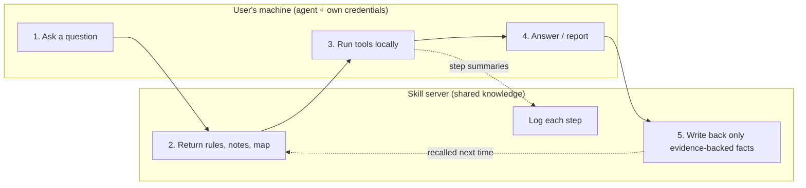

# tribal-knowledge

**Turn your team's tribal knowledge into a living skill that every agent shares — and that only learns from evidence.**

[中文说明](README.zh-CN.md)

> Status: design and spec. A minimal reference implementation is planned.

---

## The problem

Every team has *tribal knowledge*: the things that live only in people's heads.

- "The search index on that log store only covers the `message` field — filter on that, not `level`."
- "Orders in that region are in a different database."
- "Error E4021 means the wallet service, not the payment gateway."

Coding agents are now good enough to investigate problems on their own, but each agent starts from zero. The lesson one teammate's agent learned yesterday is gone today, and the next teammate pays for it again.

The usual fixes don't hold up:

| Approach | What goes wrong |
|---|---|
| A static skill file / runbook | Nobody updates it; it drifts from reality |
| Per-user agent memory | Knowledge stays siloed with one person |
| "Remember everything" shared memory | Fills up with guesses, hallucinations and stale facts — and the next agent trusts them |

## The idea

**One shared skill for the whole team, hosted on a server, that grows every time someone uses it — but only writes down what was actually verified.**

Four principles:

1. **One shared skill.** Knowledge lives on a server. Every teammate's agent reads from and writes to the same skill through [MCP](https://modelcontextprotocol.io).
2. **Execute locally.** Tools and credentials stay on each user's machine. The server holds knowledge, never secrets, and never runs the user's tools.
3. **Evidence-gated writes.** A fact can only be written if the current session actually ran an operation that produced a result supporting it. Guesses, recollections and "it matches a past case" go into reflection, not into the knowledge base.
4. **Write back automatically.** No review queue, no approval step. If the evidence is there, the knowledge is saved; the next person benefits immediately.

## How it works

1. The user asks their agent a question. A thin local *bootstrap* skill tells the agent to call `skill_open`.
2. The server parses the question, recognizes which entities it involves, and returns: instructions to follow, the most relevant notes, and a **map** of the entities and resources involved.
3. The agent runs tools **locally** with the user's own credentials, and logs a short summary of every step back to the server (`skill_log_step`).
4. The agent answers, then closes the session (`skill_close`).
5. The agent submits what it learned (`skill_update`). The server accepts a fact only if it cites steps from this session that returned real results.

The next teammate who asks a similar question gets those facts back in step 2.

## Knowledge model: map + notes

- **Map**: entities and resources, and the relations between them (`calls`, `has_resource`, `contains`). Example: `service:checkout` → `has_resource` → `resource:prod:logstore:checkout-api`. The map tells the agent *where to look*.
- **Notes**: free text with tags — experiences ("next time check X first"), document sections, past cases, and instructions. Notes tell the agent *what we've learned*.

Notes are retrieved by a mix of tag matching, vector similarity and full-text search. The map is expanded from the entities recognized in the question.

## Evidence gate: keeping the shared brain clean

A shared knowledge base is only as good as its worst entry. Agents are very good at sounding confident, so the server enforces the rules instead of trusting the agent:

- Every write must cite steps from **this session** whose result was a real observation (`ok`, `no_data`, `wrong_mapping`).
- A session with **no** such step can only submit feedback and reflection. Everything else is rejected with `needs_evidence`.
- Changing an existing note **with** evidence overwrites it (the old version is kept and can be reverted). Changing it **without** evidence creates a new note marked as conflicting, so both sides stay visible.
- A conclusion marked `confirmed` in a session with no real observations is automatically downgraded to `likely`.

We learned this the hard way: an agent without permission to read the logs "solved" a problem by matching it to an old case, reported it as confirmed, and announced that "the new findings have been saved". Nothing had been verified. See [docs/design.md](docs/design.md#lessons-learned).

## More in the design

- **Question types**: troubleshooting, data lookup and how-to questions follow different flows and output templates.
- **Auto-registering repositories**: the agent reports the current directory's git remote; if the repository isn't on the map yet, it analyzes it and registers it.
- **Self-updating bootstrap**: the server reports the bootstrap version; outdated clients refresh themselves.
- **Revert by session**: every change records before/after, so a whole session's writes can be undone.
- **Redaction and injection checks** before anything enters shared knowledge.

Full design: [docs/design.md](docs/design.md) · Tool spec: [docs/spec.md](docs/spec.md)

## Related work

| Project | Similar | Different |
|---|---|---|
| [HolmesGPT](https://github.com/HolmesGPT/holmesgpt) | Agent investigates incidents using runbooks | Runbooks are static; no shared knowledge that grows |
| [Graphiti](https://github.com/getzep/graphiti) | Temporal knowledge graph with provenance, MCP server | General memory; no evidence gate on writes |
| [Cognee](https://github.com/topoteretes/cognee) | Graph + vector memory, distills sessions into long-term memory | General memory layer; no local-execution / evidence model |
| [Mem0](https://github.com/mem0ai/mem0) | Persistent memory for agents | Per-user scopes; add-only rather than evidence-based updates |
| [ACE](https://arxiv.org/abs/2510.04618), [ExpeL](https://github.com/LeapLabTHU/ExpeL) | Context / insights that evolve from experience | Single agent on benchmarks, not a team |

What seems uncommon here is the combination: **one skill shared by a team, tools executed locally with each user's own credentials, and writes gated by in-session evidence.**

## License

MIT
