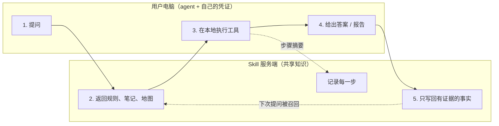

# tribal-knowledge

**把团队里只存在于人脑中的经验，变成一个所有 agent 共用、越用越聪明的 Skill，而且它只记录有证据的事实。**

[English](README.md)

> 状态：设计与接口规范。最小参考实现在计划中。

---

## 要解决的问题

每个团队都有"部落知识"（tribal knowledge）：没写进文档、只在某些人脑子里的经验。

- "那个日志库只给 `message` 字段建了索引，别用 `level` 过滤。"
- "那个地区的订单在另一个数据库里。"
- "报错 E4021 的话，问题在钱包服务，不在支付网关。"

现在的 coding agent 已经能自己动手排查问题，但每个 agent 都从零开始。昨天一个同事的 agent 踩过的坑，今天另一个同事的 agent 还会再踩一遍。

常见做法都有问题：

| 做法 | 问题 |
|---|---|
| 静态的 Skill 文件 / runbook | 没人更新，慢慢和实际情况脱节 |
| 每个人自己的 agent 记忆 | 知识只留在一个人那里 |
| "什么都记"的共享记忆 | 混进猜测、幻觉和过期信息，下一个 agent 还会信以为真 |

## 这个想法从哪来

最开始是我给自己做的一套本地方案：[agent-skill-patterns](https://github.com/tingfengyinyue/agent-skill-patterns)。它是一个基于文件的本地知识库：每次任务按"感知 → 规划 → 执行 → 反思"走完后，把教训写成 Markdown 格式的"操作记忆"；用低成本的索引按需加载；经验和事件、服务之间双向关联。用下来效果不错，也推荐给了其他团队。

但一到多人共享，问题就出来了：

- **每份拷贝各自走偏**：每个人用自己的一份，一个人的 agent 学到的东西，别人永远拿不到。
- **写进去的内容没人把关**：经验由 agent 自己写、可信度也自己打，写错的经验只能事后靠人发现、手工订正。
- **关键词索引撑不住规模**：召回依赖标签精确命中，笔记一多，相关的经验就会漏掉。
- **维护全靠人**：双向链接、命中次数、生命周期字段都是约定，需要有人持续维护一致。
- **敏感信息混进来**：没有脱敏环节，本地笔记里混进了凭证和内部细节，没法直接分享。
- **更新传不到人**：改进一条规则，需要每个人重新拷贝文件，结果大多数拷贝一直停在旧版本。

这个项目保留了其中有效的部分（反思循环、带触发条件的经验、先便宜后深入的加载方式、知识的生命周期），把知识搬到一个所有 agent 共用的服务端，并且**由服务端而不是 agent 决定什么能写进去**。详见 [docs/design.md](docs/zh/design.md#0-background-from-a-local-skill-to-a-shared-one)。

## 核心思路

**全团队共用一个托管在服务端的 Skill，每次使用都会让它成长，但只写入真正验证过的东西。**

四条原则：

1. **共用一个 Skill**：知识放在服务端，每个人的 agent 通过 [MCP](https://modelcontextprotocol.io) 读写同一份 Skill。
2. **在本地执行**：工具和凭证都留在用户自己的电脑上。服务端只管知识，不碰凭证，也不替用户执行工具。
3. **有证据才写入**：只有本次会话里实际执行过、并拿到结果的操作，才能作为写入事实的依据。猜测、回忆、"和历史案例一样"只能写进反思，不能进知识库。
4. **默认写回，高风险的改动要审批**：不打扰提问的人。目前，有证据的写入立即生效，并且可以按会话撤销。规划中会加入**按风险分级的审批队列**：低风险的新增照样直接写入；高风险的改动（覆盖高可信的笔记、让知识失效、修改地图）进入队列，由领域负责人审批。详见 [设计文档 §6](docs/zh/design.md#planned-risk-tiered-review-queue)。

## 工作流程

1. 用户向自己的 agent 提问。本地一份很薄的"引导文件"让 agent 调用 `skill_open`。
2. 服务端解析问题，识别涉及哪些实体，返回：需要遵循的指令、最相关的笔记，以及相关实体和资源的**地图**。
3. agent 用用户自己的凭证在**本地**执行工具，每一步都把简短摘要回传给服务端（`skill_log_step`）。
4. agent 给出答案，结束会话（`skill_close`）。
5. agent 提交学到的东西（`skill_update`）。服务端只接受引用了本次会话中真实结果的事实。

下一个问类似问题的同事，在第 2 步就能拿到这些事实。

## 知识模型：地图 + 笔记

- **地图**：实体、资源，以及它们之间的关系（调用、拥有资源、包含）。例如 `service:checkout` → 拥有资源 → `resource:prod:logstore:checkout-api`。地图告诉 agent **去哪里查**。
- **笔记**：带标签的文字，包括经验（"下次先查 X"）、文档段落、历史案例和指令。笔记告诉 agent **我们学到了什么**。

笔记通过标签匹配、向量相似度和全文检索三路召回；地图从问题中识别出的实体展开。

## 证据门禁：让共享的大脑保持干净

共享知识库的质量取决于其中最差的那一条。agent 很擅长说得很笃定，所以由服务端强制执行规则，而不是相信 agent：

- 每次写入都必须引用**本次会话**里结果是真实观察的步骤（`ok`、`no_data`、`wrong_mapping`）。
- 一次真实观察都没有的会话，只能提交评价和反思，其他写入一律被拒绝（`needs_evidence`）。
- **有证据**地修改已有笔记会覆盖它（旧版本保留，可撤销）；**没有证据**的修改会新建一条并标记为冲突，两种说法都保留。
- 没有任何真实观察的会话，如果结论标成"已确认"，会被自动降为"推断"。

这是踩坑踩出来的：一个没有日志读取权限的 agent，把问题和一个旧案例对上，报告"已确认"，还宣布"新发现已写入知识库"，但实际上什么都没验证。详见 [docs/design.md](docs/zh/design.md#lessons-learned)。

## 设计里的其他部分

- **问题分类**：排障、数据查询、操作指引走不同的流程和输出模板。
- **自动登记代码仓库**：agent 上报当前目录的 git 地址；如果地图里还没有这个仓库，agent 会分析仓库并登记。
- **审批队列（规划中）**：高风险的改动交给领域负责人审批，审批时并排展示改动前后的差异和引用的证据；其余写入仍然自动完成。
- **零感知更新**：指令、笔记和地图在每次提问时实时获取，服务端改好一条规则，所有人的下一次提问立刻生效，不需要任何人重新安装。本地只有一份很薄的引导文件，版本变化时会自己更新。
- **知识新鲜度**：每条笔记都带"最后一次被确认有效"的日期。超过 90 天没被确认的标为 `stale`，排序降低，只当作需要核实的线索；在有真实证据的会话里被评为有用的笔记，会自动刷新这个日期。
- **按会话撤销**：每次修改都记录改前改后，可以把一次会话的写入整体撤销。
- 写入共享知识前做**脱敏和注入检测**。

完整设计：[docs/design.md](docs/zh/design.md) · 工具接口：[docs/spec.md](docs/zh/spec.md)

## 相关项目

| 项目 | 相似之处 | 不同之处 |
|---|---|---|
| [HolmesGPT](https://github.com/HolmesGPT/holmesgpt) | agent 按 runbook 排查故障 | runbook 是静态的，没有会成长的共享知识 |
| [Graphiti](https://github.com/getzep/graphiti) | 带来源追溯的时序知识图谱，有 MCP 服务器 | 通用记忆，写入没有证据门禁 |
| [Cognee](https://github.com/topoteretes/cognee) | 图谱 + 向量记忆，把会话沉淀为长期记忆 | 通用记忆层，没有本地执行和证据模型 |
| [Mem0](https://github.com/mem0ai/mem0) | agent 的持久记忆 | 按用户划分范围；只新增，不按证据更新 |
| [ACE](https://arxiv.org/abs/2510.04618)、[ExpeL](https://github.com/LeapLabTHU/ExpeL) | 从经验中演进的上下文 / 经验库 | 单个 agent 在基准测试上运行，不是团队共用 |

这里比较少见的是这个组合：**团队共用一个 Skill，每个人用自己的凭证在本地执行工具，写入要有本次会话的证据。**

## 许可证

MIT
